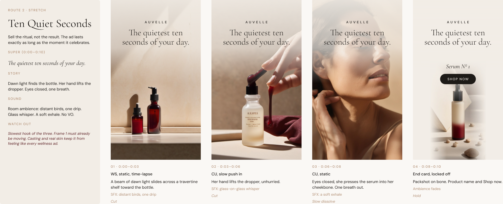

# prompr

**An AI skill that works like an agency creative team.** Give it a brief and a mood board. It sets the bar, writes its own prompts, generates routes, critiques them against the brief, and hands you finished boards, model-ready prompts and Figma layouts.

**Beta · v0.1 · Claude skill · MIT license** · Style library: [prmpr.com](https://preview.prmpr.com)



## What it makes

- **Adcepts:** three concept routes (on brief, stretch, bold), each with a headline and alternates, key visual, layout, campaign extensions and format adaptations.
- **Video storyboards:** frames with timing, shot, visual, sound, supers and transitions, a continuity sheet, plus still and video prompts for every shot (Midjourney, GPT Image, Gemini, Flux, Ideogram, Veo, Sora, Kling, Runway).

Banners, email and websites are next. Ask for them today and prompr will do the concept stage, which carries over to any tactic.

## How it works

1. **Outcome first.** It turns your brief into one outcome, an audience truth and a single-minded proposition. It asks at most five questions and flags every assumption.
2. **Mood board to recipe.** Figma frames, screenshots, brand guidelines or a [prmpr style](https://preview.prmpr.com) become one locked visual recipe and a verbal tone.
3. **Set the bar.** Three to five testable success criteria, plus craft checks for the tactic.
4. **Self-prompt.** It writes a creative brief to itself, which you can reuse in any LLM.
5. **Go wide, then narrow.** Eight to twelve raw ideas, scored and cut to three named routes. It checks in before building.
6. **Make, critique, revise.** It builds the work, scores it against the criteria, fixes what fails and tells you what still does not land.
7. **Deliver.** A markdown job doc with routes, boards and prompts, and Figma boards if Figma is connected.

## Use a look from prmpr.com

Click any thumbnail on [prmpr.com](https://preview.prmpr.com) to copy its style block, then paste it in with your brief:

```
prmpr style: Risograph Print (still)
style: risograph print illustration
details: flat graphic shapes
look: two-color fluorescent pink and teal ink, heavy grain, slight color misregistration, halftone dots, off-white uncoated paper
light: flat, no rendered lighting
aspect: 2:3
why it works: Two spot inks, grain and slight misregistration read as a physical print. The imperfections are the style.
```

prompr uses it as the base look. Your brand guidelines and mood board refine it, and the subject always comes from your brief.

## Install

**Claude Code:** copy the skill folder into your skills directory, then run `/prompr` or just ask for concepts or a storyboard.

```
git clone https://github.com/daibot/prompr.git
cp -r prompr/skill/prompr ~/.claude/skills/prompr
```

**Claude apps:** zip the `skill/prompr` folder and upload it where your plan supports custom skills.

**Other LLMs:** paste `skill/prompr/SKILL.md` and the files in `references/` into a new conversation, then send your brief.

## Figma

With the [Figma MCP server](https://developers.figma.com/docs/figma-mcp-server/) connected, prompr can read your mood boards and brand variables and build boards in a file you choose. It uses live text, colour variables and components so the team can take over. It asks before writing into any file it did not create and before spending Figma AI credits. Without Figma it asks for screenshots instead.

## Rules it follows

- Every idea points back to the outcome.
- Headlines, supers and legal copy are live text, never baked into generated images.
- In pharma, healthcare, finance and alcohol it never invents claims. It marks them "needs substantiation".
- Client material stays confidential and is not sent to outside services without your okay.
- Looks are described by their qualities, never "in the style of" a living artist.

## Example

See the [Auvelle skincare test run](examples/auvelle-skincare/README.md): three 10-second 9:16 storyboards and three 16:9 adcepts for a made-up brand, built end to end in Claude Code with Figma.

## Status

Beta. Tested in Claude Code with the Figma MCP server on one synthetic brief. Results vary by model, host and tools. Review all claims and copy before anything goes to a client. Feedback is welcome in [issues](https://github.com/daibot/prompr/issues); use synthetic or redacted examples only, never client-confidential material.

## About

Designed by [daibot](https://github.com/daibot) and developed with AI assistance. Licensed under [MIT](LICENSE). No affiliation with or endorsement by Anthropic, Figma or any model provider is implied.
