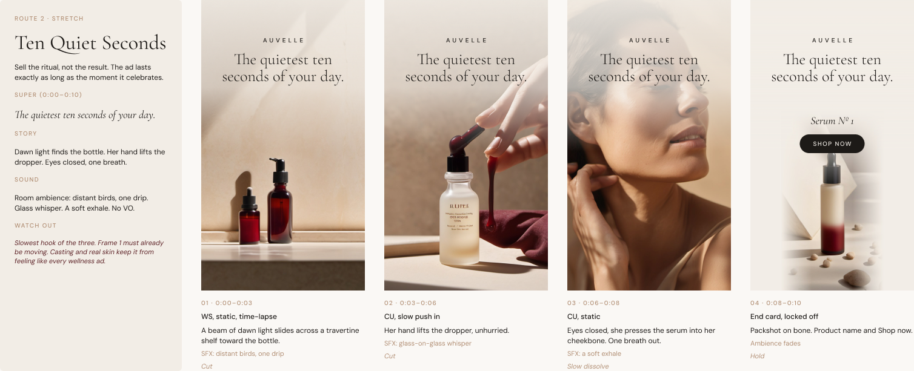
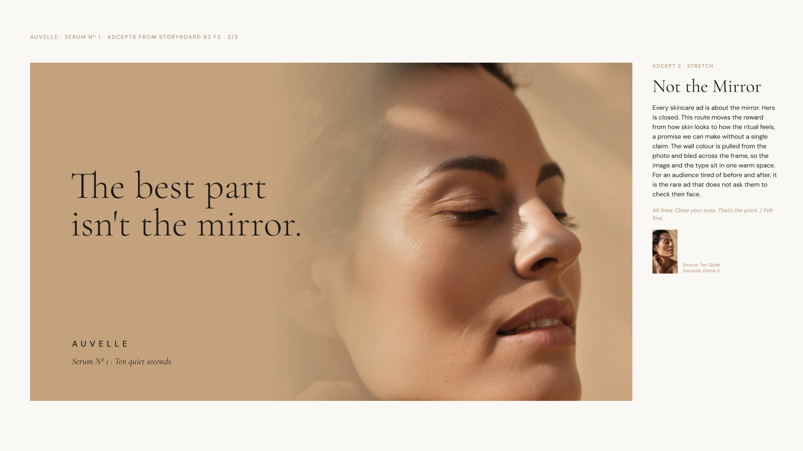

# Auvelle Serum Nº 1: 10s social storyboards

prmpr v1 · 3 routes · 9:16 · 10 seconds · 4 frames max · built in Figma with the Figma MCP

Synthetic test run. Auvelle is a made-up brand; the frames are rough local SDXL renders.





## Assumptions
Auvelle is a fictional brand. Hero product, audience, CTA and platforms are assumed. Swap in a real brief to rerun.

## Brief
```
BRAND: Auvelle (fictional), premium skincare. Hero: Serum Nº 1
OUTCOME: premium skincare buyers tap through to the Serum Nº 1 product page
AUDIENCE + TRUTH: women 30 to 50 who already spend on skincare; they have tried every serum and tune out promises. What they love is the ritual
INSIGHT: luxury skincare is sold on results but bought for how it feels to use
SMP: Auvelle makes the daily ritual feel like a luxury
TONE: quiet, assured, sensorial, not clinical
CHANNEL / FORMATS: Reels, TikTok, Stories. 9:16, 10s, sound off first
MANDATORIES: logo, product name, "Shop now". No efficacy claims
SUCCESS: tap-through rate; 3-second hold rate
```

## Visual recipe
```
RECIPE: Quiet Ritual
style:   high-end editorial skincare photograph
details: matte travertine surfaces, one oxblood accent (the cap)
look:    [bone and warm sand palette, fine film grain, restrained minimal composition, negative space in the upper third, 85mm shallow depth of field]
light:   soft diffused morning window light from the side, gentle long shadows
ar:      9:16
action:  slow, deliberate, one movement per shot
camera:  locked off or slow push in
seconds: 2 to 3
palette_hex: [bone #F2EDE6, sand #DCCDBB, clay #B08D72, oxblood #5B1F24, ink #1D1A17]
type:    supers in Cormorant Garamond Light, sentence case, centered upper third; brand and CTA in DM Sans Medium, caps, wide tracking
logo:    "AUVELLE" bug top center from 0:00, inside the top safe zone
avoid:   [gloss, water splashes, lab coats, before/after, glow effects, molecules]
```
Tone: quiet, assured, sensorial, not clinical. Short sentences. No exclamation marks. Sample line: "One drop. The whole ritual."

## Success criteria
1. Stops the scroll in second one, sound off: motion or contrast in frame 1.
2. Brand on screen by 0:03 (logo bug from 0:00).
3. The super reads in about 1 second, stays the full 10s, sits inside the safe zones.
4. Feels premium: one idea, slow movement, negative space, 4 shots or fewer.
5. Clear tap-through: product name and Shop now on the end card for 2s.

## Self-prompt (reusable in any LLM)
```
You are the creative team on Auvelle, a premium skincare brand. Outcome: premium skincare
buyers tap through to the Serum Nº 1 page. Audience truth: they have tried every serum and
tune out promises; they love the ritual. Proposition: Auvelle makes the daily ritual feel
like a luxury. Tone: quiet, assured, sensorial, not clinical. Look: Quiet Ritual.
Make 3 routes for a 10-second 9:16 social video, 4 frames max, one headline super on screen
the whole time. The routes must differ in strategy, not just look. Each must pass: scroll stop
in second one with sound off, brand by 0:03, super readable in 1s, premium restraint, a clear
end card with Shop now. Avoid: before/after, efficacy claims, lab imagery, water splashes,
glow, competitor products.
```

## Ideas considered
| # | Idea | Verdict |
|---|---|---|
| 1 | One drop: the product proven by its texture | Kept (Route 1, on brief) |
| 2 | Ten quiet seconds: the ad is as long as the ritual | Kept (Route 2, stretch) |
| 3 | Edit your shelf: fewer, better things | Kept (Route 3, bold) |
| 4 | Ingredient origin, field to bottle | Cut: category cliché, too much story for 10s |
| 5 | Before/after skin | Cut: claim risk, clinical |
| 6 | ASMR texture close-ups | Cut: same idea as 1, weaker |
| 7 | Mirror reflection that ages backward | Cut: implied efficacy claim, gimmick |
| 8 | Abstract light, product revealed at the end | Cut: fails brand by 0:03; best part folded into Route 2 |
| 9 | Bottle as sculpture in a gallery | Cut: premium but no human benefit, weak tap-through |
| 10 | Founder's handwritten note | Cut: needs VO or long reads, fails sound off |

## Critique pass
- **Route 1:** the bottle first appeared at 0:05, so it failed brand by 0:03. Fixed with a logo bug from 0:00 and the oxblood cap visible on the dropper in frame 1. Still weak: macro liquid shots rarely look premium from AI tools. Plan on a high-speed liquids shoot or heavy iteration.
- **Route 2:** the slowest hook. Fixed by making frame 1 a time-lapse that is already moving at 0:00. Still weak: it could look like any wellness ad. Casting and real, unretouched skin are what make it Auvelle's.
- **Route 3:** opening on clutter fights "premium" for 2s. Kept on purpose, flagged for the client. Props are unlabeled so it never reads as a competitor attack. "Edit your shelf" is an attitude, not a "replaces your routine" claim. Have legal confirm.
- **All:** supers are 4 to 7 words; the longest ("The quietest ten seconds of your day.") needs about 1.5s to read, which is fine since it holds the full 10s.

## Routes and frames
Super holds 0:00 to 0:10 in the same position on every frame. End card: product name, Shop now, packshot.

### Route 1 · On brief · One Drop
Super: **One drop. The whole ritual.**
| # | Time | Shot | Visual | Sound | Transition |
|---|---|---|---|---|---|
| 1 | 0:00–0:02 | ECU macro, static, 120fps | A single golden drop swells at the dropper tip, backlit | Soft room tone | Cut on the drop's release |
| 2 | 0:02–0:05 | ECU macro, high speed, slight tilt follow | The drop lands on a cheekbone and melts into skin | One tink on impact | Match cut on the glint |
| 3 | 0:05–0:08 | MCU, slow push in | Bottle on a travertine plinth, raking light, long shadow | Warm low swell begins | Slow dissolve |
| 4 | 0:08–0:10 | End card, locked off | Packshot on bone, product name, Shop now | Music resolves | Hold |

### Route 2 · Stretch · Ten Quiet Seconds
Super: **The quietest ten seconds of your day.**
| # | Time | Shot | Visual | Sound | Transition |
|---|---|---|---|---|---|
| 1 | 0:00–0:03 | WS, static, time-lapse | A beam of dawn light slides across a travertine shelf toward the bottle | Distant birds, one drip | Cut |
| 2 | 0:03–0:06 | CU, slow push in | Her hand lifts the dropper, unhurried | Glass-on-glass whisper | Cut |
| 3 | 0:06–0:08 | CU, static | Eyes closed, she presses serum into her cheekbone, one breath out | A soft exhale | Slow dissolve |
| 4 | 0:08–0:10 | End card, locked off | Packshot on bone, product name, Shop now | Ambience fades | Hold |

### Route 3 · Bold · Edit Your Shelf
Super: **Edit your shelf.**
| # | Time | Shot | Visual | Sound | Transition |
|---|---|---|---|---|---|
| 1 | 0:00–0:02 | Overhead, locked off | Crowded counter of unlabeled bottles; ours is the only oxblood cap | Busy clinks, then silence | Cut |
| 2 | 0:02–0:05 | Overhead, locked off, stop-motion | Products vanish one by one on the beat | Soft clicks, accelerating | Cut |
| 3 | 0:05–0:08 | Overhead, slow push in | Only the Auvelle bottle remains, centered, one long shadow | Silence, then one low note | Slow dissolve |
| 4 | 0:08–0:10 | End card, locked off | Packshot on bone, product name, Shop now | Note rings out | Hold |

## Continuity sheet
```
recipe:     Quiet Ritual
product:    a small frosted glass serum bottle with a dark oxblood red dropper cap
character:  a woman in her late thirties with natural unretouched skin texture and dark hair pulled back
location:   a quiet bathroom with matte travertine stone shelves and counters, bone walls
grade:      bone and warm sand, soft contrast, fine film grain
```
Reuse these lines word for word. Real production needs a real product for frames with the bottle; AI will not hold the exact packaging.

## Prompts
Stills: Midjourney (for boards and start frames). Shots: Veo (generates sound) and Kling (image to video from the still). Text is never baked in; supers and end card copy are set in Figma.

### Route 1
**F1 still (Midjourney)**
```
high-end editorial skincare photograph of the glass tip of a serum dropper with a dark oxblood red cap, a single clear golden drop forming, backlit glow, plain bone background, bone and warm sand palette, fine film grain, restrained minimal composition, negative space in the upper third, 85mm shallow depth of field --ar 9:16 --style raw --v 7
```
**F1 shot (Veo)**
```
A 2-second high-end editorial skincare macro shot of a single clear golden serum drop swelling at the glass tip of a dropper with a dark oxblood red cap, then releasing. Locked-off camera, extreme close up, slow motion. Bone background, soft backlight, fine film grain, negative space in the upper third. Audio: soft room tone, no dialogue, no music.
```
**F2 shot (Veo)**
```
A 3-second high-speed macro shot of a single clear serum drop landing on the smooth skin of a cheekbone and melting in, real skin texture with fine pores. Slight tilt following the drop. Soft diffused side window light, bone and warm sand palette, fine film grain. Audio: one clean glass-like tink on impact, no dialogue.
```
**F3 shot (Kling, from the F3 still)**
```
a small frosted glass serum bottle with a dark oxblood red dropper cap on a travertine stone plinth, slow push in, raking side light and a long soft shadow, high-end editorial skincare photograph, bone and warm sand palette, fine film grain
```

### Route 2
**F1 shot (Veo)**
```
A 3-second time-lapse wide shot of a quiet bathroom at dawn. A beam of warm light slides across a matte travertine shelf toward a small frosted glass serum bottle with a dark oxblood red dropper cap. Locked-off camera. Faint steam haze, bone walls, fine film grain, negative space in the upper third. Audio: distant birds, a single water drip, no dialogue, no music.
```
**F2 shot (Kling, from the F2 still)**
```
a woman's hand gently lifting the dropper out of a small frosted glass serum bottle with a dark oxblood red dropper cap, unhurried, slow push in, warm side window light, travertine shelf, high-end editorial skincare photograph, bone and warm sand palette
```
**F3 shot (Veo)**
```
A 2-second close up of a woman in her late thirties with natural unretouched skin texture and dark hair pulled back. Eyes closed, she presses serum into her cheekbone with her fingertips and breathes out slowly. Static camera, warm soft side light, bone and warm sand palette, fine film grain. Audio: a soft exhale, quiet room tone, no dialogue.
```

### Route 3
**F1 still (Midjourney)**
```
high-end editorial overhead flat lay of a crowded bone travertine bathroom counter covered with many plain white and clear unlabeled skincare bottles, jars and tubes, one small frosted glass serum bottle with a dark oxblood red dropper cap among them, soft side window light, fine film grain --ar 9:16 --style raw --v 7
```
**F2 shot (Veo)**
```
A 3-second overhead stop-motion shot of a bone travertine counter. Plain unlabeled skincare bottles and jars disappear one by one on the beat, leaving more empty stone each time. Locked-off camera, soft side window light, fine film grain. Audio: one soft click per disappearance, accelerating, no dialogue, no music.
```
**F3 shot (Kling, from the F3 still)**
```
a small frosted glass serum bottle with a dark oxblood red dropper cap lying alone in the center of an empty bone travertine counter, overhead, slow push in, one long soft shadow, high-end editorial skincare photograph, fine film grain
```

### End card (all routes)
**Packshot still (Midjourney)**
```
luxury product packshot of a small frosted glass serum bottle with a dark oxblood red dropper cap standing alone in the lower half of the frame on a seamless bone white background, soft shadow, soft diffused side light, fine film grain, generous empty space above --ar 9:16 --style raw --v 7
```

## prmpr recipe (rerun or extend)
Paste the self-prompt above with the Quiet Ritual recipe into prmpr or any LLM. To extend: add a :06 cutdown (frames 1 and 4 of any route), a 1:1 feed version, or adcepts that share the same supers.

---

# Adcepts from storyboard R2 F3
Figma page "Adcepts / from R2 F3" · 16:9 slides (1920×1080, ad at 1440×810)

## Recipe reverse-engineered from the frame
```
RECIPE: Sunlit Stillness
style:   editorial beauty portrait, tight crop
details: three-quarter profile facing right, chin lifted, eyes closed, hand resting at the nape
look:    [warm sand wall #C4A27D, real skin texture with fine lines kept in, warm skin tones, soft grain]
light:   hard warm window sun with dappled shadow across the cheek
negative space: sand wall, right edge only (extend it in layout)
```

## Adcepts
1. **On brief · Do Not Disturb.** "Do not disturb." / "The part of your morning nobody else gets." Split layout: bone type panel left, photo right. Alts: Back in ten. / Please hold. / Out of office.
2. **Stretch · Not the Mirror.** "The best part isn't the mirror." Wall colour sampled from the photo and bled across the frame. Alts: Close your eyes. That's the point. / Felt first.
3. **Bold · Unbothered.** "Unretouched. Unbothered." Full bleed, tight on skin texture, ink shade at the base. Needs genuinely unretouched final photography and a legal check on "unretouched". Alts: Nothing to fix. / Real skin, left alone.

Shared endline: AUVELLE · Serum Nº 1 · Ten quiet seconds.

## Critique notes
- Adcept 1 repeated "ten quiet seconds" in body and endline; body rewritten.
- "Do not disturb." is the least ownable line (hotels use it). The endline carries the brand link; the series of polite refusals is what makes it Auvelle's.
- Adcept 3 is a 2.5x crop of a 768px render, so it is soft. Production needs a high-res shoot.
